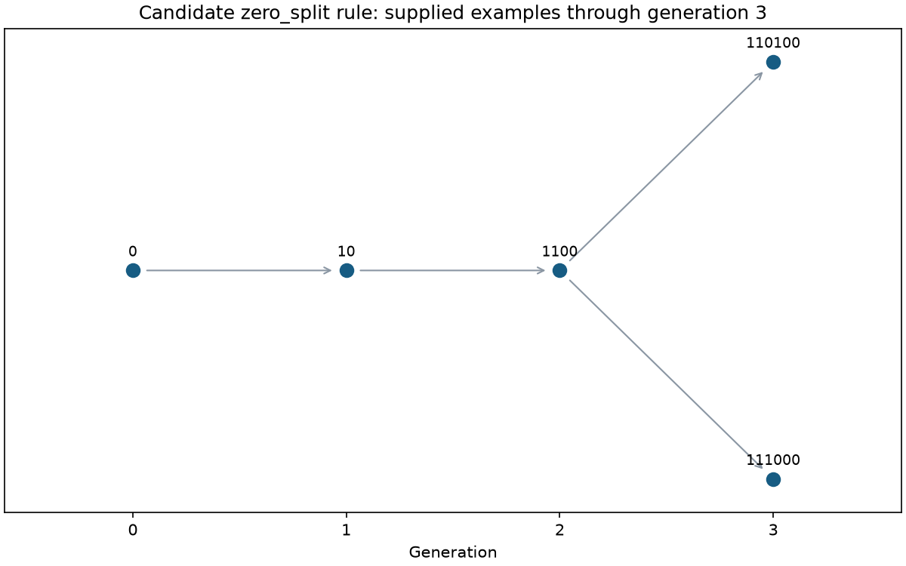

# Initial research results

This record describes executed finite experiments and a separately proved conditional statement. The experiments used the prepared Python 3.12 cloud environment. The source was under active development, so parameters and commands are recorded here; future publications should also identify the reviewed commit and retain the corresponding run metadata.

## Structural comparison

**COMPUTATIONAL RESULT.** The registered `structural-growth` experiment was run through generation 5 with all three candidate rules and visual artifacts:

```bash
research-lab run structural-growth --params '{"max_generation":5,"visualize":true}' --seed 0 --output results
```

Counts of distinct states, including the exceptional generation-0 seed:

| Generation | `zero_split` | `zero_occupancy` | `dyck_insertion` |
| --- | --- | --- | --- |
| 0 | 1 | 1 | 1 |
| 1 | 1 | 1 | 1 |
| 2 | 1 | 1 | 2 |
| 3 | 2 | 1 | 5 |
| 4 | 5 | 1 | 14 |
| 5 | 14 | 1 | 42 |

The zero-splitting candidate generated the exact original examples `0`, `10`, `1100`, `111000`, and `110100`, with their supplied parentheses correspondences. The experiment's four automated validation predicates passed. It produced 21 figures: HTML/SVG/PNG trees for each of the five original examples, plus HTML/SVG generation transition diagrams for each of the three rules.

**Interpretation.** Literal `0→10` replacement fails the original `10→1100` example: it produces `110`. Inserting `10` at arbitrary gaps allows the supplied examples but also includes `1010` at generation 2. Thus selected examples do not identify a unique transformation law or exhaustive state space.

Representative diagrams are retained for review:



The two original third-generation structures have different tree shapes:
[111000](../figures/structural/original-111000.png) and
[110100](../figures/structural/original-110100.png).
The [SVG history](../figures/structural/generation-history.svg) can be exported at arbitrary resolution.

## Conditional mathematical result

**THEOREM.** Under the explicitly defined `zero_split` rule, generation n≥1 is exactly the primitive Dyck words with n pairs, equivalently rooted ordered trees with n nodes. Its size is C(n−1), rather than C(n).

The full proof appears in [the candidate formalism](structural_formalism.md). It uses an explicit tree encoding, identifies a zero split with appending a last-child leaf, proves reachability by removing an appropriate leaf, and removes the exterior pair to establish the Catalan index shift. The finite count table checks the implementation; it is not the proof.

**Scope.** This result establishes a relationship for one chosen formal model. It does not prove that the semantic statements uniquely select that model, constitute a new combinatorial discovery, or explain physical emergence.

## Independent scientific workflow checks

**COMPUTATIONAL RESULT — classical mechanics.** The harmonic-oscillator experiment was executed with 1,000 integration steps under its documented default initial conditions and parameters. The maximum absolute state error against the analytic solution was approximately `7.904640414446718e-10`; maximum energy drift was approximately `6.944056440971735e-12` in the model's SI energy units. These observations validate the implementation over that run, not arbitrary parameter regimes.

```bash
research-lab run harmonic-oscillator --params '{"steps":1000}' --seed 0 --output results
```

**COMPUTATIONAL RESULT — information theory.** A Bernoulli sampling experiment with 1,000 samples, p=0.5, and seed 42 produced 480 ones and 520 zeros. Its empirical symbol entropy was `0.9988455359952018` bits.

```bash
research-lab run entropy-sampling --params '{"samples":1000,"probability":0.5}' --seed 42 --output results
```

This entropy describes the sample's marginal symbol frequencies. It is not a measure of state-space size, the probability of a structural history, or evidence for cosmological emergence.

## Notebook validation

**COMPUTATIONAL RESULT.** All thirteen source notebooks were executed in fresh Python kernels from the repository root using `nbclient`. The notebook assertions completed, including exact notation round trips, candidate-rule differences, Catalan count cross-checks through the documented finite range, numerical reference checks, seeded repeatability, and the optional QuTiP comparison. Each notebook generated a visualization through the reusable library. Source notebook outputs remain cleared for readable review; outputs were retained outside the checkout during validation.

## What remains unproven

- Which formal rule, seed convention, and counting interpretation the original semantic theory intends.
- Whether a particular stabilization constraint has a uniquely justified mathematical or physical interpretation.
- Any new claim about the origins of the universe, physical laws, or correspondence to measured observables.
- Any general complexity claim inferred merely from increasing generation counts or plotted examples.

See [the research agenda](research_agenda.md) for precise next decisions and questions. No experiment is automatically promoted into a theorem, and no theorem about a defined combinatorial model supplies physical validation.
